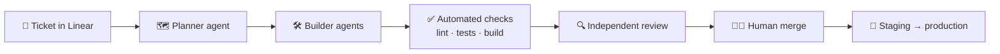

### Hey, I'm Filip 👋 Founder & Engineer at [BEASTINCT](https://beastinct.com) 🦁

I build apps, platforms, websites and AI agents with a senior team in Prague.
**AI writes the code. A human signs off every change.**

#### 🧠 How I run engineering

- 🤖 A team of AI agents with clear roles: planner, builders and an independent reviewer. I merge.
- 🔒 Mistakes that repeat become automated checks, so quality never depends on anyone's memory.
- 🌿 One ticket, one branch, one pull request.

#### 🔭 Right now

- 🦁 Leading client projects, our own products and partnerships at BEASTINCT.
- 🃏 Building [Plandeck](https://plandeck.app): real-time scrum poker with AI-assisted estimation, integrations across Jira, Linear, GitHub, Azure DevOps and Teams. Solo-built, paying customers.
- 💳 Senior frontend engineering in enterprise teams: card payments, checkout and an internal healthcare platform. Testing standards, CI/CD and AI tooling.

#### 🧰 Stack I reach for

⚡ Fun facts

- I first sat at a computer at four. By fifth grade I was modifying Minecraft Java plugins.
- Not the standard-issue engineer: design, art, cars and tattoos are a big part of life too.
- Our team is called *the Pack* (Smečka in Czech).
- Every agent works in its own branch. None of them can merge.

📬 [beastinct.com](https://beastinct.com) · [LinkedIn](https://www.linkedin.com/in/filiptes) · hello@beastinct.com
